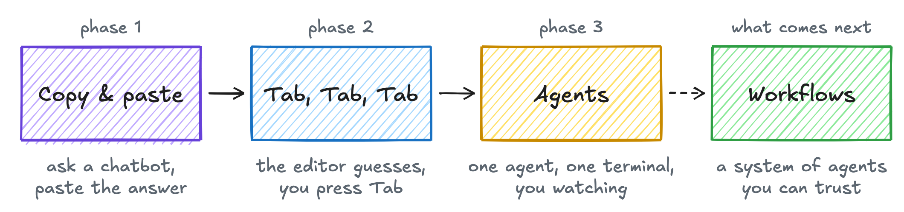
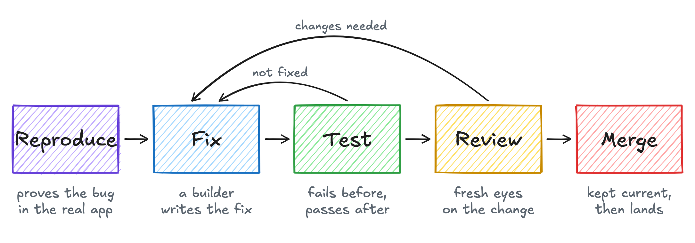
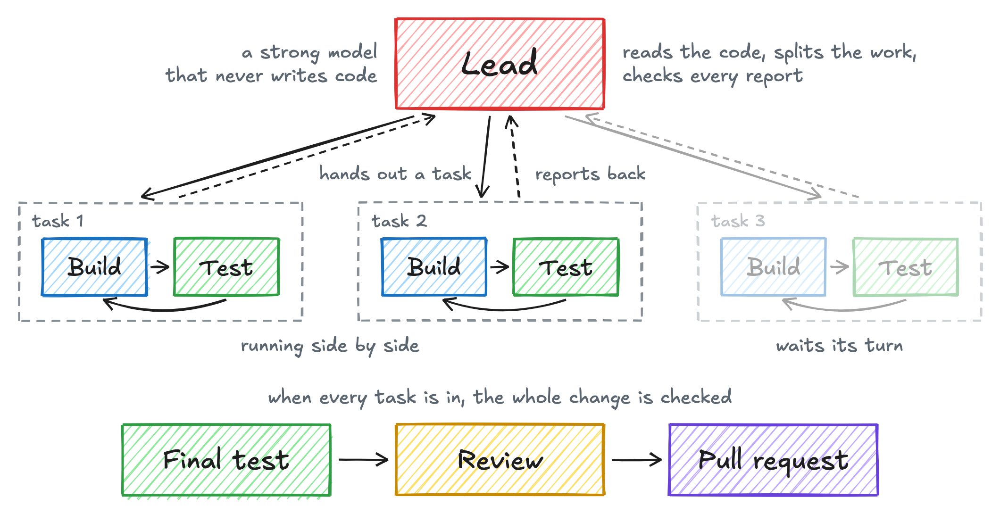

<h1 align="center">Kipster Software Factory</h1>

<p align="center">
  <b>Give it a ticket. Get back a pull request you can trust.</b>
</p>

## How AI coding grew up

<picture>
  <source media="(prefers-color-scheme: dark)" srcset="docs/assets/phases-dark.png">
  
</picture>

**Phase 1: Copy and paste.** We asked ChatGPT a question, copied the answer into
our editor and fixed whatever didn't compile. The AI knew nothing about our
code. Fitting the answer in was our job.

**Phase 2: Tab, Tab, Tab.** The AI moved into the editor. It guessed the next
line and we pressed Tab. Typing got faster, but we still wrote every function
and read every line.

**Phase 3: Agents.** Claude Code, Codex and others started doing the work. We
say what we want, and the agent reads the code, changes it and runs the tests.
Most of the time we don't read every line anymore. But we still sit with it:
one agent, one terminal, and us watching.

## What comes next

The next step isn't a smarter agent. It's a system.

You hand a task to the system and walk away. Inside, different agents do
different jobs. One breaks the work down, one builds, one tests it in the
running app and one reviews. When something isn't right, it goes back around.
You only step in for decisions that are yours to make.

For that to work, you have to trust the system. That trust doesn't come from
one good model. It comes in layers, built into the workflow.

That's why I built the Kipster Software Factory.

## Everything is a workflow

Think about how you fix a bug. First you reproduce it, then you fix it. Then you
check that the fix really works, and someone reviews the code. If anything is
wrong, it goes back.

The factory does exactly that.

<picture>
  <source media="(prefers-color-scheme: dark)" srcset="docs/assets/bug-dark.png">
  
</picture>

1. A **reproducer** shows the bug happening in the real app.
2. A **builder** fixes it.
3. A **tester** shows the bug failing on the old code and passing on the new.
4. A **reviewer** reads the change. Anything wrong goes back to the builder.
5. The pull request stays current with its base branch and CI, and lands
   through the merge gate.

A workflow is a short YAML file:

```yaml
name: bug
description: Reproduce the bug first, fix it, prove the fix and land it.
steps:
  - id: reproduce
    kind: agent
    role: reproducer
  - id: fix
    kind: agent
    role: builder
  - id: test
    kind: agent
    role: tester
    limit: 3
    routes:
      changes-needed: fix
  - id: review
    kind: agent
    role: reviewer
    routes:
      changes-needed: fix
  - id: merge
    kind: system
    action: merge
```

## My favorite: the lead

<picture>
  <source media="(prefers-color-scheme: dark)" srcset="docs/assets/lead-dark.png">
  
</picture>

For anything bigger than a bug, I give the ticket to a lead. The lead is a
strong model; at the time of writing I use Claude Opus 5.5. It's the
coordinator for the whole task.

First it reads the code, understands the ticket and breaks the work into small
pieces. Each piece goes to its own small workflow, where a builder makes it and
a tester proves it. When a piece is done, it reports back to the lead. The lead
checks it, then hands out the next one. When pieces don't depend on each other,
the lead runs them side by side.

When every piece is in, a tester checks the whole change against the ticket, a
reviewer reads it end to end, and it comes to you as one pull request.

## In a nutshell

The factory gives you a team of roles. Each one does one job well.

- **Lead:** breaks big work into small tasks and coordinates them. Never writes code.
- **Planner:** turns a ticket into a short plan with checks a tester can run.
- **Reproducer:** proves the bug happens in the real app before anyone fixes it.
- **Builder:** writes the code and commits it.
- **Tester:** didn't write the change. Proves it works in the running app.
- **Reviewer:** reads the change for serious problems and sends it back if it finds any.
- **Explorer:** makes designs, prototypes and research you open in the browser.
- **Validator:** checks an explorer's work against what you asked for.

A workflow can also have two kinds of step that aren't agents:

- **You:** the ticket waits until you approve, ask for changes or reject.
- **The system:** plain code, no AI. It keeps the pull request up to date and merges it.

Now combine them any way you want. A workflow is just the order they run in,
plus where each one sends the work next.

## Try it

It's 2026. I don't believe in manual installs anymore. Give this to your coding
agent and let it figure it out. It runs on macOS for now; if you need Linux or
Windows, [open an issue](https://github.com/manikanta-kops/kipster-software-factory/issues).

```
Set up the Kipster Software Factory for me. Follow https://raw.githubusercontent.com/manikanta-kops/kipster-software-factory/master/SETUP.md
```

## Learn more

- [Architecture](docs/architecture.md): concepts, modules and data flow
- [Workflow format](docs/workflows.md): every field, outcome and default
- [Workflow guide](docs/workflow-guide.md): principles for workflows you can trust
- [Repository kit](docs/kit.md): how a repository tells agents to build, run and verify it
- [Install and run](docs/install.md): manual install, the background service and defaults
- [Development](docs/development.md): run the factory from source and test it

Early development. See the [roadmap](docs/roadmap.md).
Licensed under [Apache-2.0](LICENSE).
